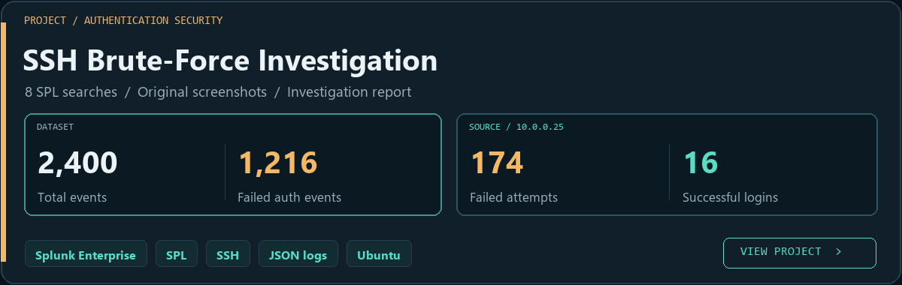

  

  <a href="#latest-repositories"><b>Latest repositories</b></a> &nbsp; / &nbsp;
  <a href="https://github.com/Majed-Almabadi?tab=repositories"><b>All repositories</b></a> &nbsp; / &nbsp;
  <a href="#tools--technologies"><b>Tools &amp; technologies</b></a>

## About me

## Latest repositories

<!-- LATEST-REPOSITORIES:START -->

<!-- LATEST-REPOSITORIES:END -->

## Project spotlight

## Tools & technologies

## My approach

