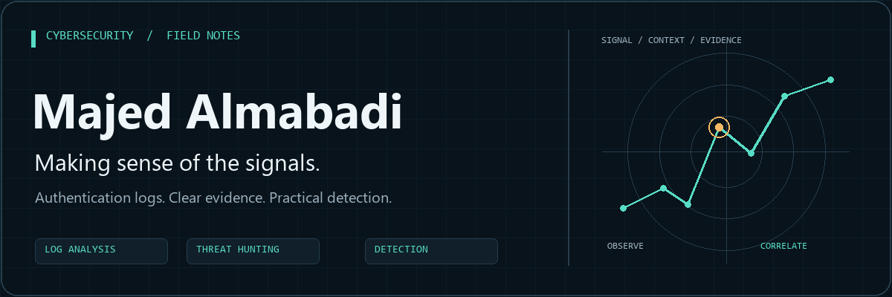
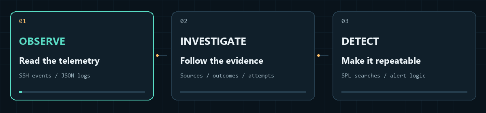
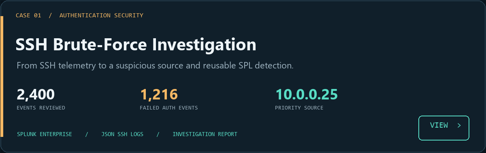
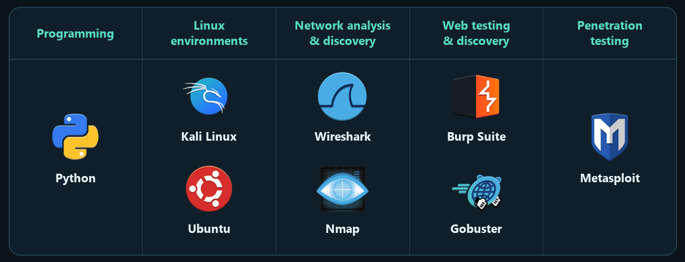

  

  <a href="#featured-investigation"><b>Featured investigation</b></a> &nbsp; / &nbsp;
  <a href="https://github.com/Majed-Almabadi?tab=repositories"><b>Repositories</b></a> &nbsp; / &nbsp;
  <a href="https://github.com/Majed-Almabadi/Detecting-SSH-Brute-Force-Attempts-with-Splunk/blob/main/Splunk_SSH_Analysis_Report.pdf"><b>Investigation report</b></a>

## From signal to evidence

I'm **Majed Almabadi**, and my current work explores cybersecurity through authentication logs, threat hunting, and detection in Splunk. I focus on connecting an observable signal to a clear finding and a repeatable search.

## Featured investigation

**[SSH Authentication Log Analysis & Threat Hunting Using Splunk](https://github.com/Majed-Almabadi/Detecting-SSH-Brute-Force-Attempts-with-Splunk)**

Investigated JSON-based SSH logs, reconstructed suspicious-source activity, and documented eight SPL searches with findings and supporting screenshots. The source investigation identified **174 failed authentication attempts** and **16 successful logins** from the same suspicious IP.

`Splunk Enterprise` &nbsp; `SPL` &nbsp; `SSH` &nbsp; `JSON logs` &nbsp; `Ubuntu`

## What I'm working with

## How I approach a case

1. **Start with the data.** Confirm ingestion and understand the fields before interpreting activity.
2. **Add context.** Compare authentication outcomes, repeated attempts, and source behavior.
3. **Make the finding useful.** Document the evidence and turn the investigation into reusable detection logic.

